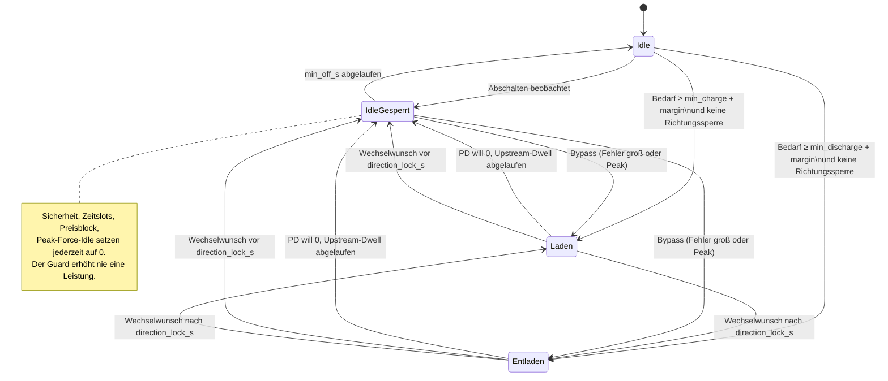

# 2. Architektur

Zwei neue Module, beide ohne Home-Assistant-Abhängigkeit in der Kernlogik (Zeit wird als Parameter übergeben). Dadurch sind sie isoliert testbar und in `__init__.py` reichen wenige Hook-Zeilen.

```
custom_components/omnibattery/control/relay_guard.py   Thema 1 (Anti-Chatter)
custom_components/omnibattery/control/grid_view.py     Thema 2 (zweiter Netzsensor, dynamisches Peak-Limit)
```

## 2.1 `RelayGuard` (Thema 1)

### Bewertung deiner Ideen

| Idee | Entscheidung | Begründung |
|---|---|---|
| Mindest-Ein-Zeit | bleibt der vorhandene `pd_relay_cooldown` | Funktioniert korrekt, nur dein Wert (15 s) ist zu klein. Kein neuer Code. |
| Mindest-Aus-Zeit | **neu** | Fehlt komplett und ist die direkte Ursache der 2–3-s-Lücken. |
| Sperre Laden ↔ Entladen über Zeit | **neu** | Hysterese und Zero-Cross begrenzen die Häufigkeit nicht. |
| Ein-/Ausschalthysterese | **neu, wichtigster Teil** | Behebt die Ursache (Schwelle ein = Schwelle aus), die Zeiten begrenzen nur das Symptom. |
| Schaltbudget pro Stunde | **neu, als Drossel** | Kein hartes Verbot. Bei Überschreitung werden die Sperrzeiten verdreifacht. Ein hartes Verbot könnte die Batterie stundenlang blockieren. |

### Schnittstelle

```python
@dataclass
class GuardDecision:
    power: float            # durchgelassene oder auf 0 gesetzte Leistung
    reason: str             # "pass", "min_off", "direction_lock", "engage_threshold",
                            # "bypass_error", "bypass_peak", "disabled"
    remaining_s: float      # Restzeit der aktiven Sperre, sonst 0

class RelayGuard:
    def configure(self, *, min_off_s, direction_lock_s, engage_margin_w,
                  bypass_error_w, budget_per_hour) -> None
    def observe(self, commanded_power: float, now: float) -> None
    def filter(self, requested: float, error: float, *, previous_power: float,
               min_charge_w: float, min_discharge_w: float,
               peak_bypass: bool, stale_recalc: bool, now: float) -> GuardDecision
    def status(self, now: float) -> dict     # für den Diagnosesensor
```

`observe` wird einmal pro Zyklus mit `previous_power` aufgerufen. Es erkennt Vorzeichenwechsel des tatsächlich gesendeten Befehls, egal welcher Pfad ihn verursacht hat (auch Force-Idle, Restriktionen, First-Execution), und führt Zeitstempel und Schaltzähler. Der Guard muss deshalb nicht an jedem Rücksprung der Regelschleife eingehängt werden.

### Regeln von `filter` (Reihenfolge ist verbindlich)

1. Schalter `pd_relay_guard_enabled` aus → durchlassen (`disabled`). Verhalten identisch zu Upstream. `configure` erhält dafür zusätzlich `enabled`.
2. `stale_recalc` → durchlassen, Zustand unverändert.
3. `peak_bypass` → durchlassen (`bypass_peak`).
4. `|error| ≥ bypass_error_w` → durchlassen (`bypass_error`). Ein echter Lastsprung wartet nie.
5. `requested == 0` oder gleiches Vorzeichen wie `previous_power` → durchlassen. Das Abschalten verzögert weiterhin der Upstream-Dwell.
6. Einschalten aus idle (`previous_power == 0`, `requested ≠ 0`):
   1. seit dem letzten Abschalten weniger als `min_off_s` vergangen → 0 (`min_off`)
   2. Richtung ≠ letzte aktive Richtung und seit deren Ende weniger als `direction_lock_s` → 0 (`direction_lock`)
   3. Bedarf in dieser Richtung kleiner als `min_power(Richtung) + engage_margin_w` → 0 (`engage_threshold`). Bedarf = `−error` beim Laden, `+error` beim Entladen. Gilt nur, wenn `min_power > 0`.
7. Direkter Richtungswechsel (`previous_power` und `requested` mit unterschiedlichem Vorzeichen): Ist die aktuelle Richtung kürzer als `direction_lock_s` aktiv → 0 (`direction_lock`). Danach greift Regel 6.
8. Sonst durchlassen.

Drossel: Liegt die Zahl der Schaltvorgänge der letzten 3600 s bei `budget_per_hour` oder darüber, gelten `min_off_s` und `direction_lock_s` mit Faktor 3. Der Status zeigt `throttled: true`.

Ein Schaltvorgang ist jeder Wechsel zwischen den drei Zuständen Laden, Idle, Entladen im gesendeten Befehl.

### Wirkung auf den Grenzzyklus

Mit `engage_margin_w = 0`, Min-Ladeleistung 50 W, Totband 40 W:

| | Upstream | Fork |
|---|---|---|
| Einschalten ab Überschuss | 10 W | 50 W |
| Fehler direkt nach dem Einschalten | +40 W (Totbandkante) | 0 W (Totbandmitte) |
| Ausschalten unter Überschuss | 10 W | 10 W |
| Hysterese | 0 W | 40 W |

Preis: Überschuss zwischen 10 W und 50 W wird nicht mehr eingesammelt, solange die Batterie idle ist.

### Zustandsmaschine



### Prioritäten

1. **Sicherheit und Restriktionen** (SOC-Grenzen, Temperatur, Alarme, Zeitslots, Blocks) laufen nach dem Guard (Stufen 17–19) oder an ihm vorbei (Stufen 1, 9). Sie können immer auf 0 setzen. Der Guard kann nur zusätzlich auf 0 setzen, nie Leistung erzwingen. Er kann also keine Schutzfunktion aushebeln.
2. **Peak Shaving** setzt `peak_bypass`. Im Peak-Fall darf sofort entladen werden.
3. **Große Lastsprünge** laufen über `bypass_error_w`.
4. Erst danach gelten die Sperren.

### Hook-Punkte in `__init__.py`

| Stelle | Änderung | Zeilen |
|---|---|---|
| Konstruktor, nahe 740 | `self._relay_guard = RelayGuard()` und `configure(...)` aus `config_entry.data` | ~8 |
| Config-Reload, nahe 3223 | `configure(...)` erneut | ~6 |
| Anfang von `async_update_charge_discharge` | `self._relay_guard.observe(self.previous_power, time.monotonic())` | 1 |
| direkt nach `_apply_relay_dwell` (10421) | `filter(...)` aufrufen, `new_power` übernehmen, Grund loggen | ~10 |

`_apply_min_power`, `_apply_relay_dwell` und `_apply_zero_cross_hold` bleiben unverändert. Das hält Rebase-Konflikte klein und die vorhandenen Tests gültig.

### Diagnose

Ein neuer Sensor `sensor.<prefix>_relay_guard` (Kategorie Diagnose):

- Zustand: `pass`, `min_off`, `direction_lock`, `engage_threshold`, `bypass_error`, `bypass_peak`, `disabled`
- Attribute: `remaining_s`, `switches_last_hour`, `switches_today`, `blocked_today`, `throttled`, `last_switch`

## 2.2 `GridView` (Thema 2)

### Schnittstelle

```python
class GridView:
    def configure(self, *, physical_entity, physical_inverted,
                  limit_entity, limit_margin_pct) -> None
    @property
    def has_physical(self) -> bool
    def read_physical(self, states, now) -> float | None   # W, +Bezug / −Einspeisung, leicht geglättet
    def physical_is_new(self) -> bool                      # Wert seit dem letzten Aufruf verändert
    def peak_limit(self, states, static_limit_w, now) -> float
    def status(self) -> dict
```

Regeln:

- **Kein zweiter Sensor konfiguriert:** `has_physical` ist `False`. Alle Aufrufer nutzen den bisherigen Wert. Verhalten identisch zu Upstream.
- **Zweiter Sensor unbrauchbar** (fehlt, `unavailable`, nicht numerisch, älter als 60 s): `read_physical` liefert `None`. Aufrufer fallen auf den Regelsensor zurück. Nach 5 Minuten entsteht ein Repair-Eintrag, analog zu `configured_sensor_missing`.
- **Dynamisches Limit:** `peak_limit` liest die Entität, zieht `limit_margin_pct` ab und begrenzt auf 500–20000 W. Ist die Entität unbrauchbar, gilt der letzte gültige Wert für höchstens 15 Minuten, danach der statische Zahlenwert.

### Änderungen an der Regelschleife

| ID | Stelle | Änderung |
|---|---|---|
| P1 | `_apply_capacity_protection` (5133) | Neuer optionaler Parameter `physical_actual=None`. `estimated_house_load` rechnet mit dem realen Wert, falls vorhanden. Das Limit kommt aus `self._grid_view.peak_limit(...)` statt direkt aus `self.capacity_protection_limit`. |
| P2 | Zweig „shaving“ (5190–5215) | Rückgabewert `sensor_actual` ist der reale Wert. Damit regelt der PD den realen Netzbezug auf das Limit. Zweig „conserving“ bleibt auf dem Regelsensor (Sollwert = Istwert, Fehler 0). |
| P3 | ICP-Clamp (10524–10532) | `sensor_filtered` durch den realen Wert ersetzen, falls vorhanden. |
| P4 | State-Listener (12055–12091) | Der reale Sensor löst ebenfalls `schedule_control_cycle()` aus. |
| P5 | Frische-Prüfung (10027–10036 und 10338–10341) | Neuer Ausdruck `peak_review_pending`: Peak Shaving aktiv **und** realer Wert neu **und** (Peak-Zweig war im letzten Zyklus aktiv oder `real − Batterie > Limit`). Dann kein früher Rücksprung, und der reale Sample zählt als neuer Regelwert. |
| P6 | Statistik und Anzeige (Tabelle in 01, Abschnitt 1.3) | Eine neue Methode `controller.read_statistics_grid_w()` kapselt „real, sonst Regelsensor“. Die Aufrufer tauschen je eine Zeile. |

P5 ist der heikelste Punkt des Projekts. Er greift in die Stale-/Kadenz-Logik ein, die Upstream in mehreren Issues gehärtet hat (#117, #522). Deshalb eigenes Arbeitspaket mit dem stärksten Modell und eigenen Tests.

### Optional: Peak-Deckel oberhalb der SOC-Schwelle

Upstream begrenzt den Peak nur unterhalb der SOC-Schwelle. Darüber verlässt es sich auf den Normalbetrieb. Mit synthetischem Regelsensor fehlt dort ein nativer Schutz, heute übernimmt das dein Template.

Vorschlag als eigene, abschaltbare Option (`capacity_protection_always`, Default aus): Der PD-Fehler wird zu `max(regel_error, real − limit)`. Liegt der reale Bezug über dem Limit, gewinnt der Peak-Fehler und die Batterie entlädt bzw. lädt weniger. Sonst regelt alles wie bisher. Aufwand gering (rund 10 Zeilen nach Stufe 8), aber erst sinnvoll, wenn P1–P5 im Feld stabil laufen. Deshalb eigenes Arbeitspaket B6.

### Bewertung „Peak-Limit aus Entität“

Aufwand gering (in `GridView.peak_limit` gekapselt, eine Entitätsauswahl im Options-Flow). Nutzen bei dir hoch: `sensor.stromkosten_peak_tarifstufe_watt` ändert sich mit der Tarifstufe, der feste Wert 13000 W muss sonst von Hand nachgezogen werden. Wird umgesetzt (AP B2).

### Ausblick: Vereinfachung deines Template-Sensors

Nicht Teil dieses Plans, nur Einordnung:

| Template-Term | Native Entsprechung im Fork |
|---|---|
| `peak · 0,9` in `erlaubt` | Peak-Deckel (B6) mit dynamischem Limit und Marge 10 % |
| `grenze_phase` (Phase C 4600 W) | vorhandenes `control/phase_power_limit.py` mit Phasenstrom-Sensor und 20-A-Sicherung. Vorher prüfen, ob es Laden begrenzt und nicht nur Entladen. |
| EEG-Anteil einsammeln, Forecast-Logik | bleibt im Template. Zu speziell für Upstream. Eine native Option „zusätzlich erlaubter Bezug aus Entität“ wäre technisch nur ein weiterer Setpoint-Offset (`_setpoint_offsets`), aber die Logik dahinter bliebe trotzdem bei dir. |

## 2.3 Thema 3: Verschlankung der Oberfläche

Wunsch: In der Übersicht des Panels nur noch den Systemstatus zeigen. Tagesbetrieb, Energiefluss, Energie heute, Wochenenergie, Leistung und SOC entfallen.

Befund:

- Das Panel ist eine einzige Datei, `frontend/marstek-panel.js` (8.114 Zeilen, 556 KB). Die Übersicht rendert `_renderResumen` (ab Zeile 2545). Konfiguration kommt über `panel_config` aus `__init__.py` (~483–545).
- Die Berechnungen hinter den Karten (`tracking/consumption_tracker.py`, `tracking/hourly_balance.py`, `pricing/daily_timeline.py`, Aggregat-Sensoren) sind **keine reinen UI-Berechnungen**. Sie speisen auch Sensor-Entitäten, das Energie-Dashboard und Funktionen wie Ladeverzögerung, prädiktives Laden und Entladereserve.

Entscheidung in drei Stufen:

| Stufe | Maßnahme | Bewertung |
|---|---|---|
| 1 | Karten per Schalter ausblenden (`panel_minimal_overview`): `_renderResumen` rendert dann nur den Systemstatus | **umsetzen** (AP C1). Etwa 15 Zeilen JS und 5 Zeilen Python, rebase-freundlich. |
| 2 | Nicht benötigte Entitäten in Home Assistant deaktivieren | **optional** (AP C2). Kein Code, jederzeit umkehrbar. Spart Recorder-Einträge. |
| 3 | Code und Berechnungen löschen | **nicht umsetzen.** Jede gelöschte Zeile in Upstream-Dateien wird bei jedem Rebase zum Konflikt, rund 60 Testdateien hängen an diesen Modulen, und andere Funktionen nutzen die Daten. Der Nutzen wäre gering: Die Rechenlast dieser Module ist klein gegenüber dem Modbus-Polling. |

Das widerspricht dem Ziel „kleiner Diff, upstream-freundlich“ nicht, solange es bei Stufe 1 und 2 bleibt. Die Komplexität, die du im Alltag siehst, verschwindet damit. Die Komplexität im Code bleibt, kostet dich aber nichts, weil der Fork sie nicht anfasst.

## 2.4 Diff-Budget in Upstream-Dateien

| Datei | Thema 1 | Thema 2 |
|---|---|---|
| `__init__.py` | ~25 Zeilen | ~50 Zeilen |
| `const/integration_const.py` | ~60 (Konstanten, 5 Number-Definitionen) | ~25 |
| `config_flow.py` | 0 | ~30 |
| `sensor.py` | ~15 (Registrierung Diagnosesensor) | ~5 |
| `strings.json`, `translations/*.json` | Einträge | Einträge |
| Statistik-Aufrufer (4 Dateien) | 0 | je 1–3 |

Alles andere liegt in neuen Dateien und erzeugt beim Rebase keine Konflikte.
